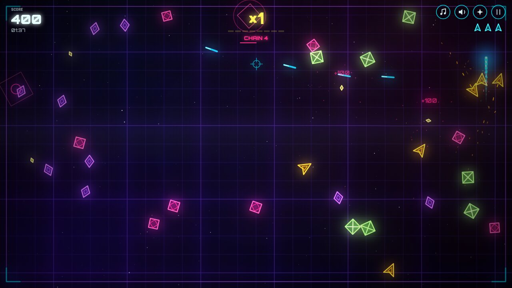

# PULSAR 2D — neon arena shooter (prototype)

**Status:** concluded. Superseded by [`../pulsar3d/`](../pulsar3d/).

## Hypothesis

A Geometry Wars-style arena shooter in a single HTML file (Canvas 2D,
procedural art and audio) can deliver a fun loop with these mechanics:

- auto-fire;
- a multiplier built from collecting sparks;
- chains and NEAR bonuses;
- 4 enemy types and 3 power-ups.

## How to run

Open `index.html` directly in the browser. It needs no server.

## Findings

- The loop works and is readable: Drifter, Chaser, Splitter and Dasher each
  have their own colour and shape, and the Dasher announces its dash with a
  dashed line.
- The user judged the result too "generic / AI-looking". The concept moved to
  real 3D with Blender models (`../pulsar3d/`).
- Technical lesson: the spring grid must be integrated with fixed-rate substeps
  (60 Hz). With a variable timestep it diverges when frames are slow.
