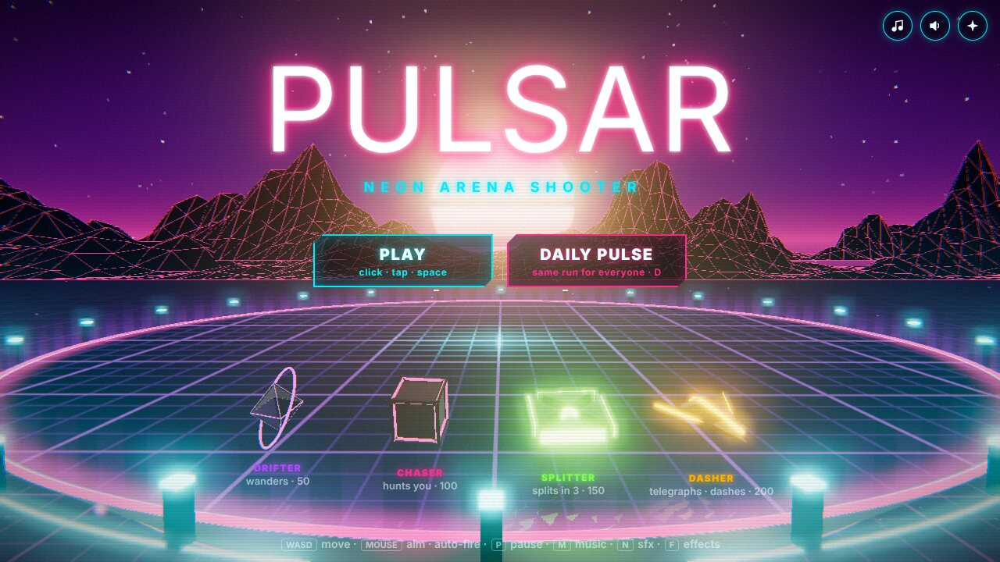
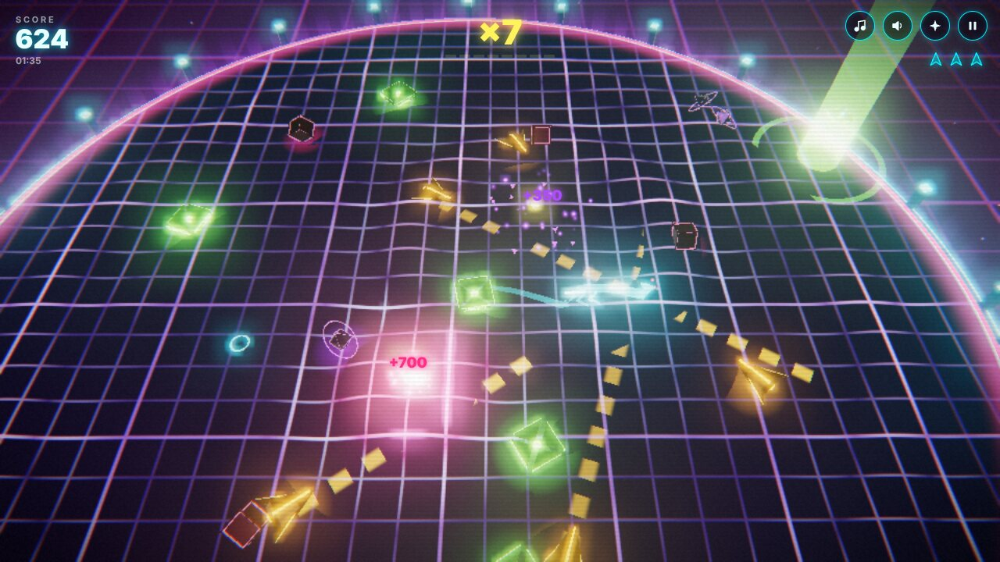
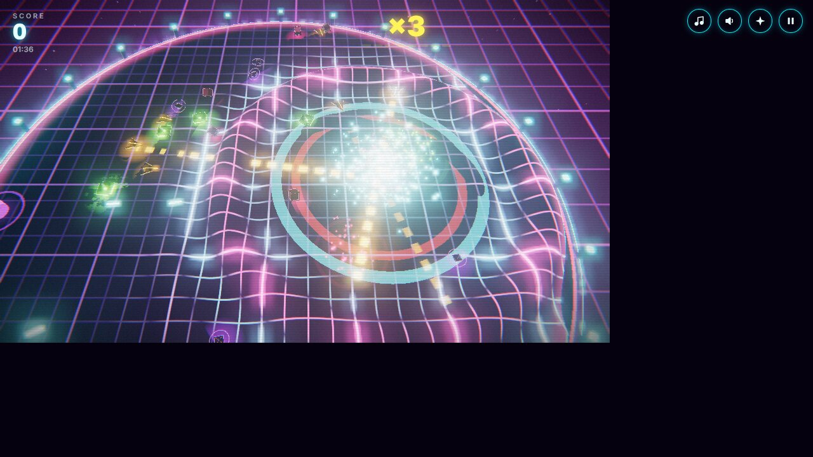
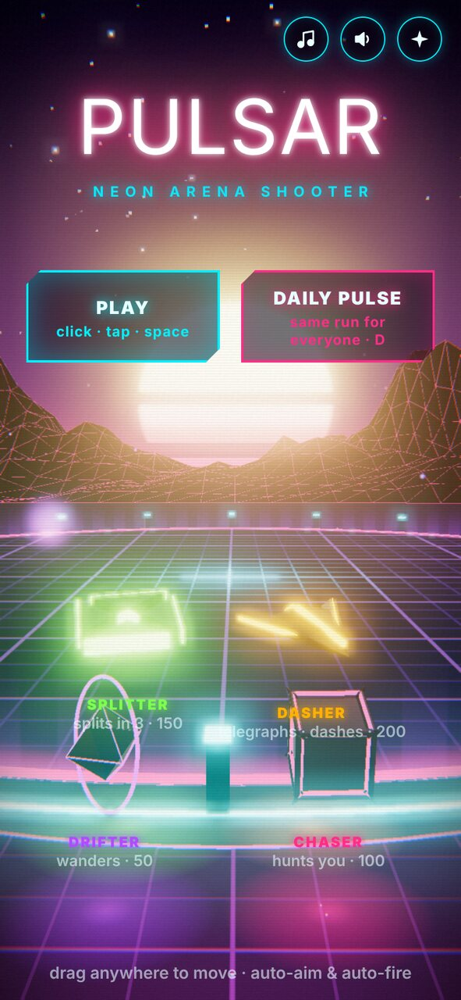
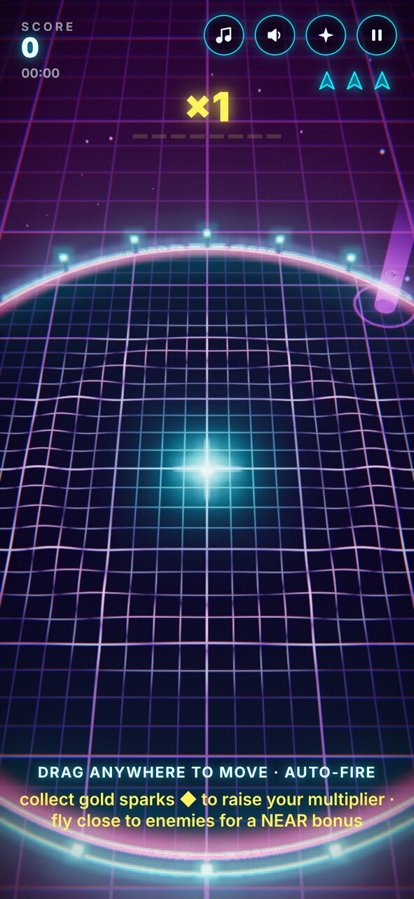
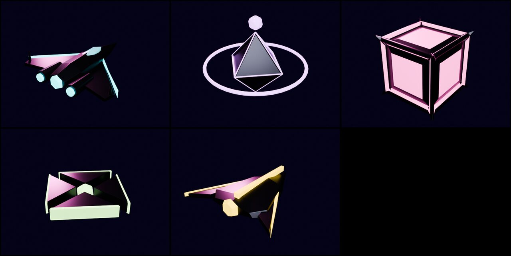

# PULSAR 3D — neon arena shooter (prototype)



**Status:** in progress (playable vertical slice of the full loop)

## Hypothesis

A short-session arena shooter (2–5 minute runs) in real 3D, with hand-modelled
assets and a synthwave look, can be readable, juicy and replayable in a browser
with no install, on desktop and mobile. The pillars:

- **Score through bold play.** The multiplier comes from collecting fading
  sparks; near-misses (NEAR) and kill chains pay extra.
- **Instant retry.** One key or tap starts a new run, and the music keeps playing.
- **Threats always readable.** Enemies are drawn above effects, every enemy type
  has its own colour and silhouette, and the grid is dimmed.

## How to run

The game must be served over HTTP, because browsers block loading the GLB from
`file://`:

```bash
cd prototypes/pulsar3d
python3 -m http.server 8000
# open http://localhost:8000
```

Three.js 0.170 is loaded from jsDelivr through an import map, so the page needs
internet access.

**Controls**

| Device | Controls |
|---|---|
| Desktop | WASD or arrows move · the mouse aims · fire is automatic · `P` pause · `M` music · `N` sfx · `F` effects full/calm · `T` menu |
| Mobile | drag anywhere to move (floating stick) · aim and fire are automatic |

Modes: **PLAY** (arcade) and **DAILY PULSE** (`Y`), where everyone gets the same
seeded run each day.

## How it's built

| Part | Tech |
|---|---|
| Models | Blender 4.2, driven headless from Python: `tools/build_assets.py` → `assets/pulsar.glb`. The models are the ship plus Drifter, Chaser, Splitter and Dasher, each with a metal body and emissive seams. |
| Rendering | Three.js. HDR pipeline: UnrealBloom → ACES → a custom pass (chromatic aberration, vignette, grain, scanlines). PMREM environment for the metals. |
| Arena | A 200×200-segment floor shader. Explosion ripples displace it in real 3D (Geometry Wars-style grid), and it carries analytic lights for flashes and for the player's light pool. |
| World | Gradient sky with stars, a retro sun with animated bands, wireframe mountains, a scrolling-grid abyss below the disc, rising embers, a rim force-field. |
| Effects | Physical debris that bounces on the disc and falls into the abyss past the rim. A 4000-point particle system, shockwave rings, dynamic lights, a ship trail ribbon, hit-stop, trauma² shake, FOV kick. |
| Audio | 100% Web Audio synthesis: synthwave music (Am–F–C–G, 104 BPM) whose layers follow the multiplier, fake sidechain, delay, generated-IR reverb. Every SFX is procedural. |

Regenerate the models:

```bash
uv run --python 3.11 --with bpy==4.2.0 python tools/build_assets.py --preview /tmp/previews
```

## Research that shaped it

Five agents fed the design: art-director, game-designer, audio-director,
producer (competitive analysis) and market research (Poki/CrazyGames/itch.io).
Market-driven decisions:

- Playable in seconds with no tutorial wall. Hints fade during the first 6 seconds.
- The first 20 seconds have slow enemies only.
- No full-screen red flashes (WCAG 2.3.1). The damage cue is an edge-only vignette,
  rate-limited.
- Effects full/calm toggle (shake ×0.3, no aberration, fewer particles). It
  defaults to calm with `prefers-reduced-motion`.
- Separate music and sfx toggles, always visible. Auto-pause on blur or tab hide,
  with explicit resume.
- Adaptive resolution and particle budget when the frame rate drops.
  `env(safe-area-inset-*)` keeps the HUD clear of notches.
- Retention without a backend: local best score, the "+N to beat your best" line,
  ranks, and the daily seed.

## Findings

- **Graphics.** The 3D version reads much more "handmade" than the 2D one.
  Real geometry, metal reflections and the 3D grid give depth that the vector
  version doesn't have.
- **Bug found and fixed (worth remembering).** Copying a `THREE.Color` into a
  `Vector3` uniform produced NaN, which the HDR bloom spread across the whole
  frame and turned it black. Any NaN in an HDR pipeline blacks out the screen.
- **Canvas sizing.** The canvas needs an explicit CSS width/height. Otherwise, on
  screens with DPR > 1 it is shown at its internal resolution and overflows the
  screen.
- **To verify by hand on a real GPU.** Feel, 60 fps on mid-range phones, and the
  audio mix by ear. Headless tests run on software rendering (~4 fps).

## Evidence

| | |
|---|---|
|  |  |
|  |  |
|  | Blender renders (Cycles) of the models |
