# PULSAR 3D — neon arena shooter (prototype)


**Status:** in progress (playable vertical slice of the full loop)

## Hypothesis

A short-session arena shooter (2–5 minute runs) in real 3D, with hand-modelled
assets and a synthwave look, can be readable, juicy and replayable in a browser
with no install, on desktop and mobile. The pillars:

- **Score through bold play.** The multiplier comes from collecting fading
  sparks; near-misses (NEAR) and kill chains pay extra.
- **Instant retry.** One key or tap starts a new run, and the music keeps playing.
- **Threats always readable.** Enemies are drawn above effects, every enemy type
  has its own colour and silhouette, and the grid is dimmed.

## How to run

The game must be served over HTTP, because browsers block loading the GLB from
`file://`:

```bash
cd prototypes/pulsar3d
python3 -m http.server 8000
# open http://localhost:8000
```

Three.js 0.170 is loaded from jsDelivr through an import map, so the page needs
internet access.

**Controls**: auto-fire, and you aim

| Device | Move | Aim | Dash | Menus |
|---|---|---|---|---|
| Desktop | WASD or arrow keys | the mouse: the ship fires on its own at the cursor | `SHIFT` or `SPACE` | `P`/`Esc` pause, `R` restart, `T` main menu, `M`/`N`/`F` music, sfx, effects, `G` aim mode |
| Mobile | one finger, dragged anywhere | the ship fires where you steer; an optional second finger aims | DASH button | pause button at top right, with RESUME, RESTART and MAIN MENU |

The ship never turns towards enemies on its own. **AIM: ASSIST** on the title
screen brings back automatic aiming, as an accessibility option.

Modes: **PLAY** (arcade) and **DAILY PULSE** (`Y`), where everyone gets the same
seeded run each day.

## Phase 1: depth (from player and market research)

Three research agents covered what players want, how games spread and earn, and
depth systems. Their findings agreed: runs had no decisions and no set-pieces.
Phase 1 adds:

- **Phase Dash.** 7 units in 0.15 s, invulnerable, 2.5 s cooldown. Flying
  *through* an enemy pays PHASE points (3 × the NEAR value). Four or more in one
  dash triggers OVERCHARGE, which refunds half the cooldown.
- **Five sectors** (Neon Gate → Magenta Drift → Amber Rail → Toxic Bloom → White
  Core). Each has its own floor tint, enemy mix and spawn curve. After the fifth
  the cycle repeats 15% faster.
- **The Warden.** It closes every sector. It has 3 phases set by HP and fires
  rings of orbs with a rotating 3-orb gap, plus twin spirals. Each attack is
  telegraphed by 0.6 s of glow. In phase 3 it summons drifters. Orbs can be
  grazed. Killing it turns every orb into points.
- **Upgrade cards.** Pick 1 of 3 after every 6 multiplier gains and after every
  boss. 12 cards plus 2 synergies (Photon Lance, Singularity). In the daily run
  the cards are seeded, so everyone sees the same offers.
- **Game over that teaches.** Shows what killed you, the sector you reached and
  your build. `R` retries in 0.45 s. COPY RESULT copies a shareable score card.
- **Spelunky-style daily.** Only the first attempt of the day is official; later
  ones are marked PRACTICE. Plus a daily streak counter.

## Visual Pass 1 (art direction, technical art and performance review)

Three specialists reviewed the game. The art-director looked at screenshots
against Geometry Wars, Resogun, Nex Machina and Thumper. The technical-artist
audited the rendering code. The performance-analyst audited mobile cost.

- **Signature.** The stock synthwave sunset is replaced by a **pulsar**: a
  white-blue core with twin beams that rotate once every two bars of the music.
  The same beams sweep across the arena floor during play.
- **Value hierarchy.**
  - The floor grid is darker. Minor lines are dim and fade with distance, which
    removes moiré. Only the major lines glow. Floor lighting is clamped.
  - The wake left by the ship is softer.
- **One material language.** Every enemy is a dark body with a fresnel rim in its
  own colour, so Chasers no longer read as black holes.
- **One hue per role.**
  - The Dasher is now orange (#FF8A00), so it no longer shares yellow with the
    sparks.
  - Boss orbs are red (#FF3B5C) with a white-hot core.
- **Image quality.**
  - MSAA on the HDR target: 4× desktop, 2× mobile.
  - Khronos **Neutral** tone mapping instead of ACES, chosen by A/B against ACES
    and AgX (`evidence/visual1-tonemap-ab.jpg`). Neutral keeps neon hues
    saturated.
  - Bloom retuned to threshold 0.85, strength 0.7, radius 0.4.
- **Camera.** About 61° pitch on desktop and about 72° in portrait.
- **Performance on phones.**
  - 60 fps cap, so 120 Hz Samsung panels no longer render twice the frames.
  - Quarter-resolution bloom and render scale ≤ 1.25 on mobile.
  - Polar floor mesh with no fragment `discard`.
  - Sky, pulsar and mountains are switched off once the camera looks down at
    the arena.
  - Partial particle uploads and a point-size clamp.
  - WebView renderer priority set to `IMPORTANT`, and `appCategory="game"`.
- **UI.**
  - Opaque upgrade overlay. Cards are coded by category: OFFENSE cyan, SCORE
    gold, UTILITY green.
  - Mobile HUD collisions fixed.
  - The aim-mode chip moved to a corner.
- **Feel.**
  - Haptics on touch: kills, dash, PHASE, pickups, hits, boss. Off in calm mode.
  - Bullet-time on boss kills, OVERCHARGE and 30+ chains.
  - The music goes to full intensity during the boss.

## Polish pass 2: "it feels unfinished, the sound is retro"

Five specialists worked from the same complaint: audio-director, game-designer,
ux-designer, narrative-director and technical-artist.

- **Audio.** The chiptune-style live synthesis is gone.
  - The score is a darksynth track pre-rendered at load into 8-bar loop stems
    (OfflineAudioContext, no download). Four layers follow the multiplier:
    core, drive, pulse and lead.
  - A 128 BPM boss set switches in on the bar, and the title has its own theme.
  - Every sound effect is a transient, a body and a tail. Effects are panned by
    world position, slightly randomized, capped per category, and tuned to the
    current chord. Tonal effects snap to the 1/16 grid.
  - The master chain is saturation, then a glue compressor, then a limiter, at
    about −16 LUFS. Preview: `evidence/pass2-score-preview.mp3`.
- **Type and UI.**
  - Fonts: Michroma for display, Chakra Petch for labels, Saira Semi Condensed
    for body text, and Oxanium for tabular numbers. All are served locally from
    `fonts/` under the OFL.
  - A custom SVG PULSAR logotype with open A's and a beam through the A.
  - Motion: a beam wipe and staggered entry on every screen change.
  - Banners are typed by meaning: info, reward, threat and damage.
  - Cards carry a glyph and level pips.
  - The game-over screen leads with the score, the cause of death and a death
    quip.
  - The pause screen holds the settings.
- **Completeness.**
  - Bosses: Warden, Warden, **Echo** (mirrors you and copies your dash half a
    beat late), Warden Prime, then **the Quiet** (silences the music; four pulse
    nodes seal its core, and each one you break brings a music layer back).
  - A real ending, THE BEAT HOLDS, with credits, then **Afterglow**, the faster
    endless loop.
  - Every sector has one rule, one set piece and its own weather: currents,
    rails, five-way splitters, and the White Core beam storm.
  - A first-run tutorial that teaches each move by doing it.
  - The **Star Chart**: a codex, 12 achievements and lifetime records.
- **Models and effects.**
  - New Blender models: a round lens-shaped player ship, a spiked Chaser, a
    split-chevron Dasher, a bespoke Warden with a spinning ring, and the Quiet.
  - Effects: screen-space refraction waves, edge-only reward accents, kill pops,
    floor scorch marks, dash afterimages, and a 1.8 s boss death sequence.

**Still open:**
- Instanced enemies.
- A fixed-timestep simulation.
- Gamepad support and key remapping.
- Colour-blind palettes.
- Cosmetic unlocks.
- Feel, framerate and the audio mix still need checking by ear and eye on a
  real phone.

## How it's built

| Part | Tech |
|---|---|
| Models | Blender 4.2, driven headless from Python: `tools/build_assets.py` → `assets/pulsar.glb`. The models are the ship plus Drifter, Chaser, Splitter and Dasher, each with a metal body and emissive seams. |
| Rendering | Three.js. HDR pipeline: UnrealBloom → ACES → a custom pass (chromatic aberration, vignette, grain, scanlines). PMREM environment for the metals. |
| Arena | A 200×200-segment floor shader. Explosion ripples displace it in real 3D (Geometry Wars-style grid), and it carries analytic lights for flashes and for the player's light pool. |
| World | Gradient sky with stars, a retro sun with animated bands, wireframe mountains, a scrolling-grid abyss below the disc, rising embers, a rim force-field. |
| Effects | Physical debris that bounces on the disc and falls into the abyss past the rim. A 4000-point particle system, shockwave rings, dynamic lights, a ship trail ribbon, hit-stop, trauma² shake, FOV kick. |
| Audio | 100% Web Audio. A darksynth score (A minor, 112 BPM, boss set at 128) is pre-rendered into loop stems at load; layers follow the multiplier. SFX are layered and key-locked to the chord, with saturation, glue compression and a limiter on the master. |

Regenerate the models:

```bash
uv run --python 3.11 --with bpy==4.2.0 python tools/build_assets.py --preview /tmp/previews
```

## Research that shaped it

Five agents fed the design: art-director, game-designer, audio-director,
producer (competitive analysis) and market research (Poki/CrazyGames/itch.io).
Market-driven decisions:

- Playable in seconds with no tutorial wall. Hints fade during the first 6 seconds.
- The first 20 seconds have slow enemies only.
- No full-screen red flashes (WCAG 2.3.1). The damage cue is an edge-only vignette,
  rate-limited.
- Effects full/calm toggle (shake ×0.3, no aberration, fewer particles). It
  defaults to calm with `prefers-reduced-motion`.
- Separate music and sfx toggles, always visible. Auto-pause on blur or tab hide,
  with explicit resume.
- Adaptive resolution and particle budget when the frame rate drops.
  `env(safe-area-inset-*)` keeps the HUD clear of notches.
- Retention without a backend: local best score, the "+N to beat your best" line,
  ranks, and the daily seed.

## Findings

- **Graphics.** The 3D version reads much more "handmade" than the 2D one.
  Real geometry, metal reflections and the 3D grid give depth that the vector
  version doesn't have.
- **Bug found and fixed (worth remembering).** Copying a `THREE.Color` into a
  `Vector3` uniform produced NaN, which the HDR bloom spread across the whole
  frame and turned it black. Any NaN in an HDR pipeline blacks out the screen.
- **Canvas sizing.** The canvas needs an explicit CSS width/height. Otherwise, on
  screens with DPR > 1 it is shown at its internal resolution and overflows the
  screen.
- **To verify by hand on a real GPU.** Feel, 60 fps on mid-range phones, and the
  audio mix by ear. Headless tests run on software rendering (~4 fps).

## Evidence

| | |
|---|---|
|  |  |
|  |  |
|  | Blender renders (Cycles) of the models |
| 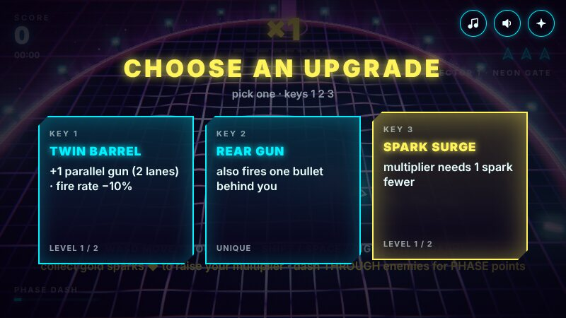 | 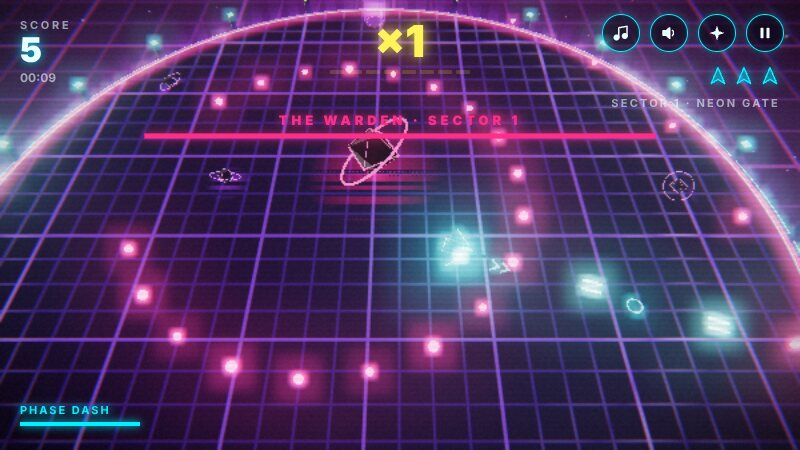 |
| 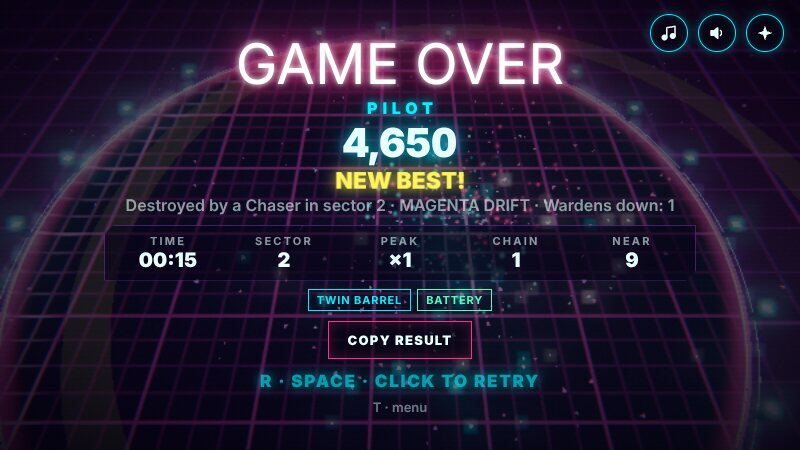 | 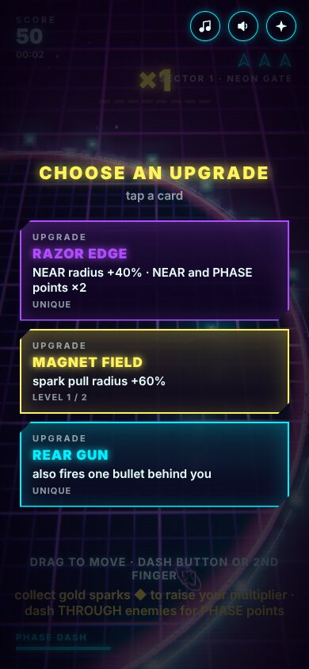 |
| 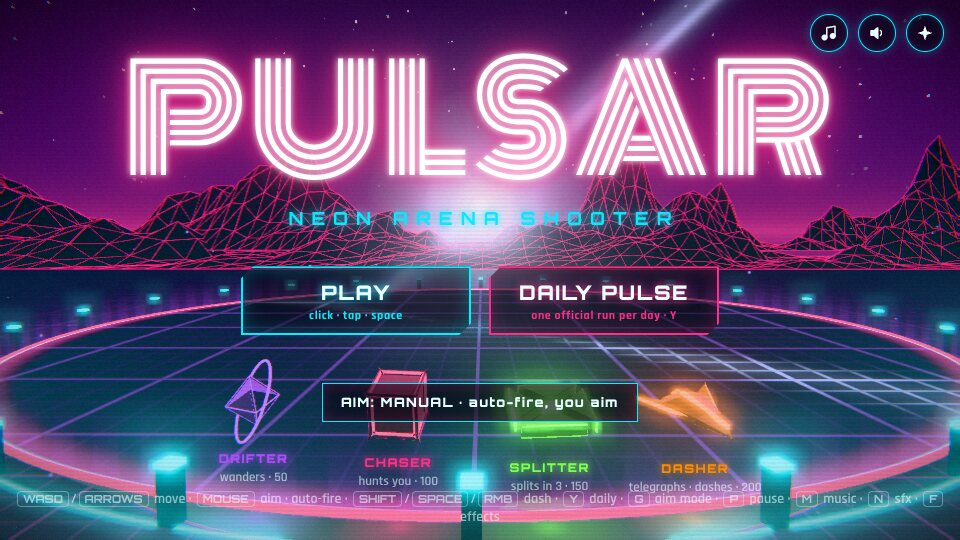 | 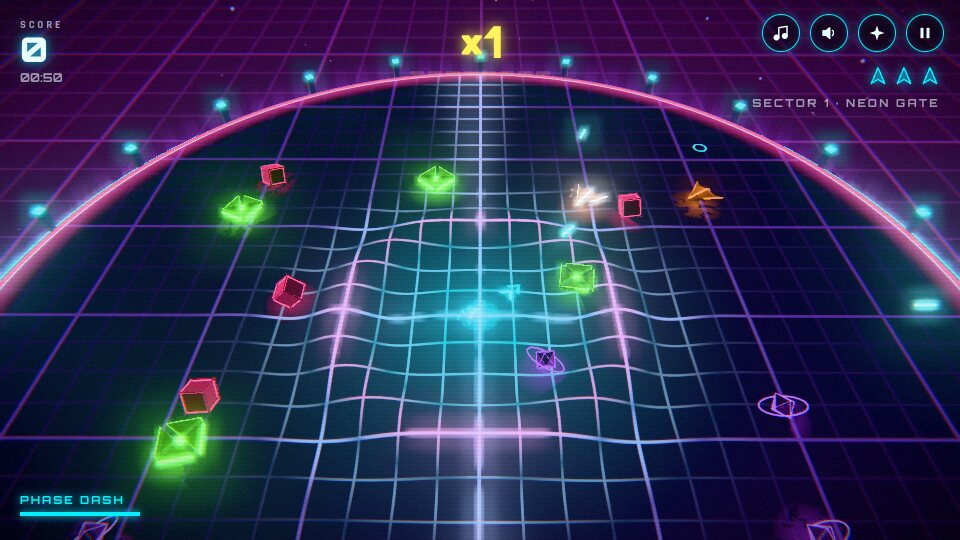 |
| 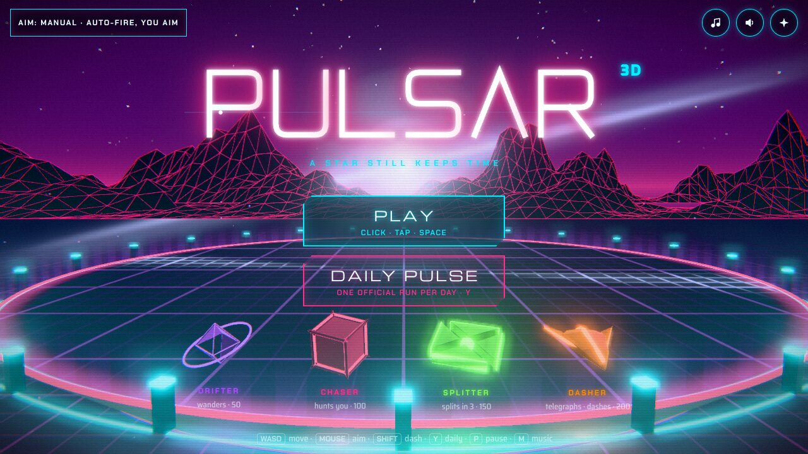 | 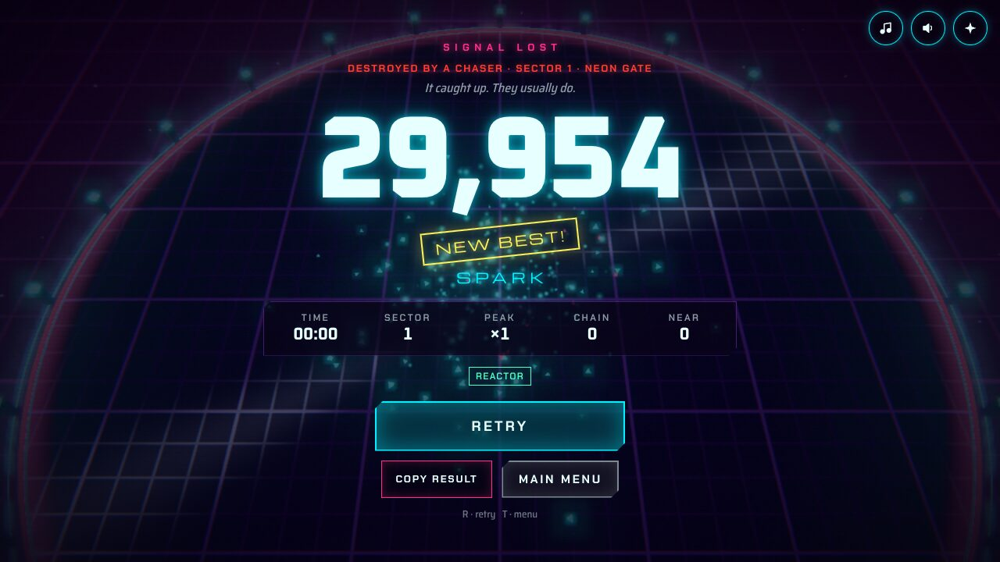 |
| 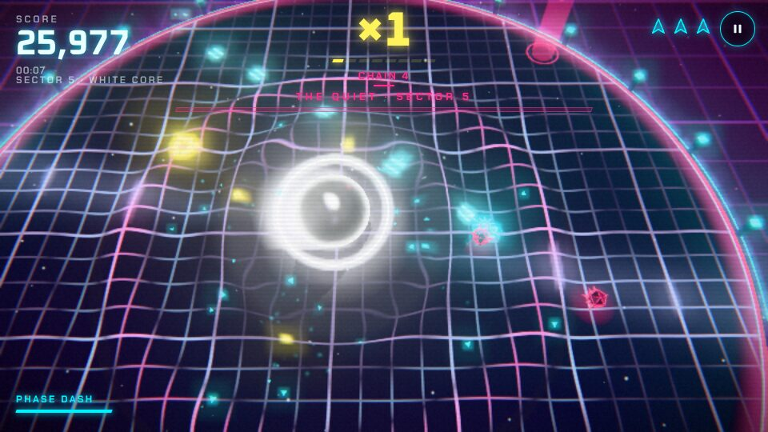 | 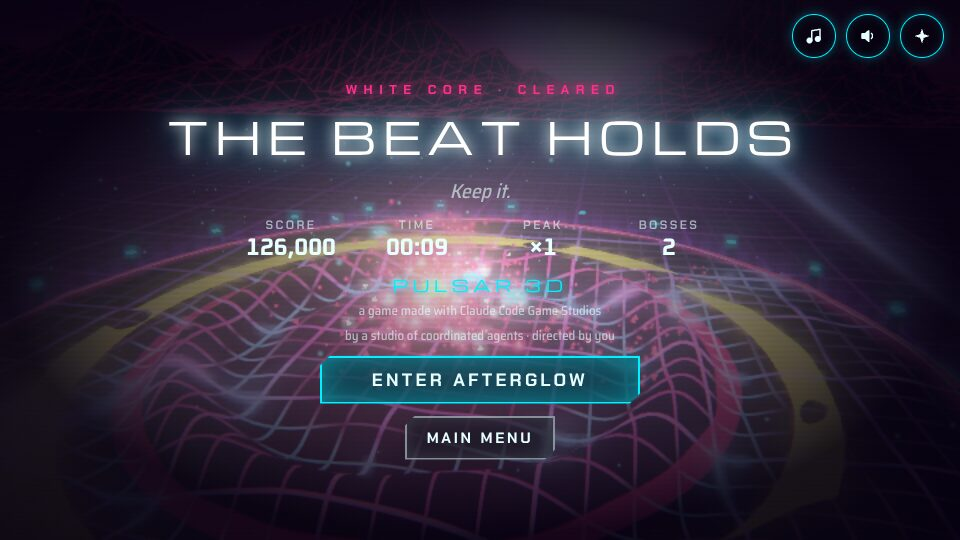 |
| 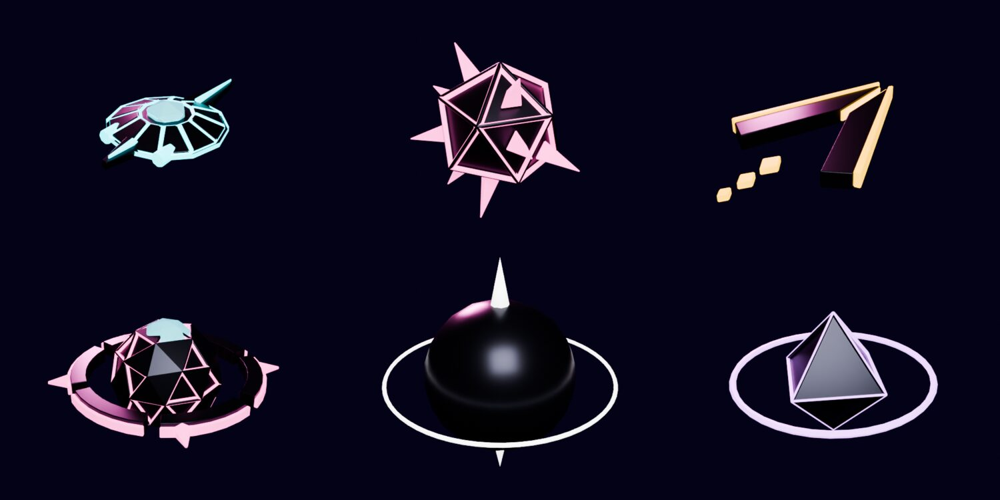 | 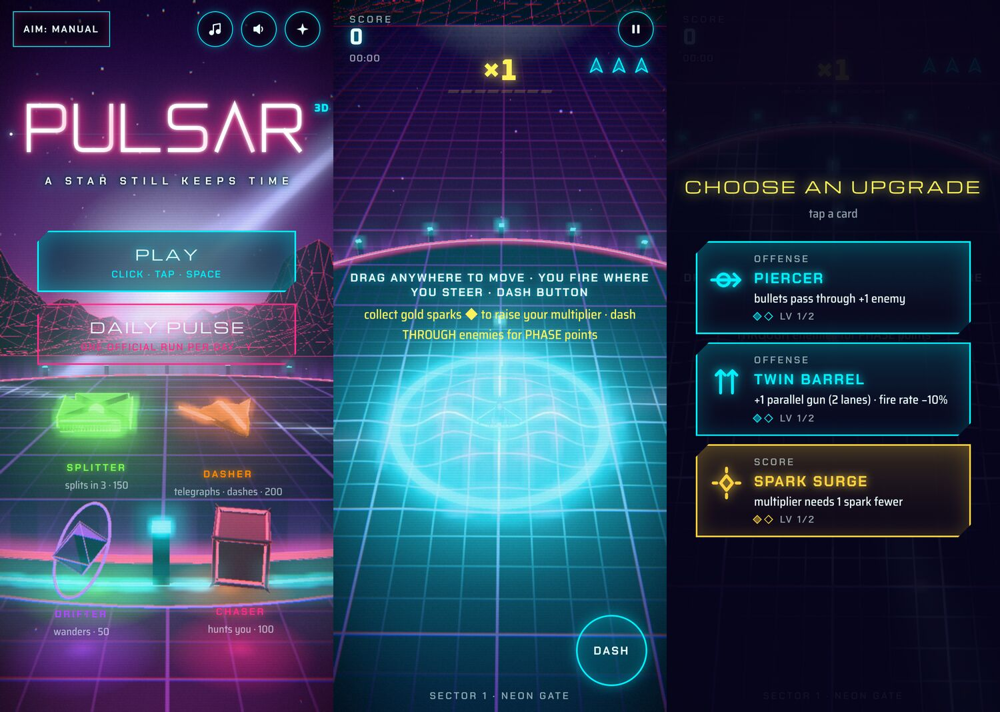 |

Score preview (title, game layers stacking, boss): `evidence/pass2-score-preview.mp3`.
